# Guía de uso · Análisis Causa Raíz

Paso a paso para quien usa la app por primera vez. Las capturas son de los **casos de
ejemplo** de la app, con una empresa ("Planta Demo"), productos y lotes inventados.

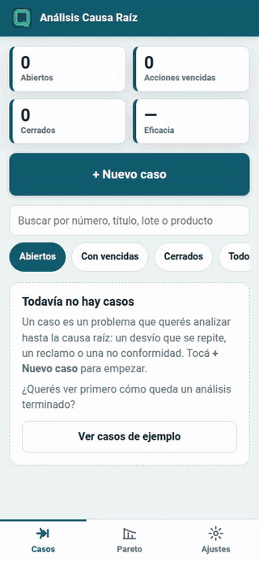

> **¿Querés verla funcionando antes de cargar nada?** Abrí la app y tocá **“Ver casos de
> ejemplo”**: aparecen 10 casos en distintos estados para abrir, editar y ver en el Pareto.
> Se borran con un toque. También hay un [video de 2 minutos y medio](video/causa-raiz-demo.mp4)
> que lleva un caso nuevo por los 6 pasos.

**Contenido**

1. [Empezar](#1-empezar)
2. [Cargar el problema](#2-cargar-el-problema)
3. [Contención](#3-contención)
4. [Ishikawa (6M)](#4-ishikawa-6m)
5. [5 por qué y causa raíz](#5-5-por-qué-y-causa-raíz)
6. [Plan de acción](#6-plan-de-acción)
7. [Verificación de eficacia](#7-verificación-de-eficacia)
8. [Informe y PDF](#8-informe-y-pdf)
9. [Pareto](#9-pareto)
10. [Ajustes y respaldo](#10-ajustes-y-respaldo)
11. [Preguntas frecuentes](#11-preguntas-frecuentes)

---

## 1. Empezar

Abrí la app: <https://roca-byte.github.io/causa-raiz/>. No hay cuentas ni claves: todo lo que
cargás queda **solo en tu celular** (o en la compu donde la uses).

La primera vez la lista está vacía. Podés tocar **+ Nuevo caso** o, para conocerla, **Ver
casos de ejemplo**. Mientras haya ejemplos, arriba de la lista aparece un aviso con el botón
**Borrar ejemplos**, que borra solo los ejemplos: si ya cargaste casos tuyos, esos quedan.

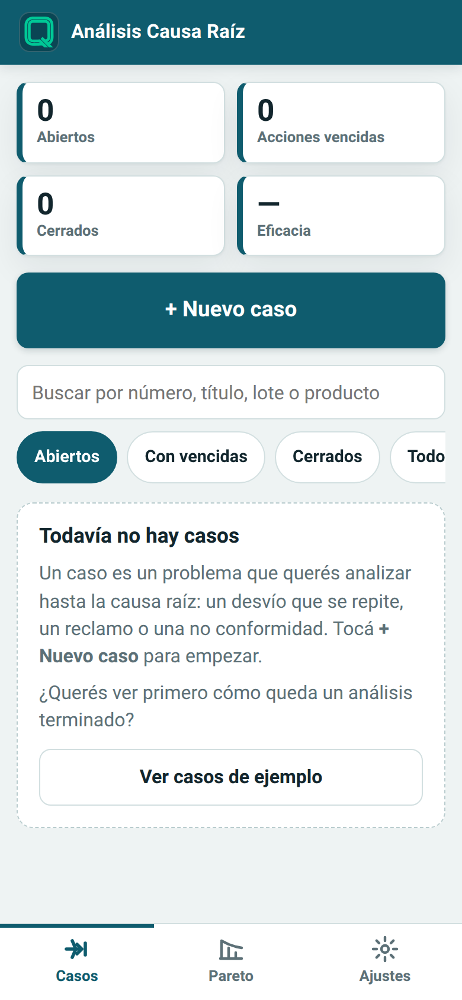 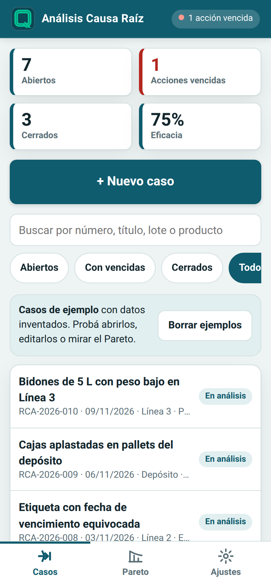

Arriba de todo están los **indicadores**: casos abiertos, acciones vencidas, casos cerrados y
porcentaje de eficacia (de los casos verificados, cuántos resultaron eficaces). Si hay
acciones vencidas, también se avisa en la barra superior.

Los filtros **Abiertos**, **Con vencidas**, **Cerrados** y **Todos**, y el buscador (por
número, título, lote o producto), ayudan a encontrar un caso.

> 💡 **Instalala en el celular:** en Chrome, menú ⋮ → *Instalar app* (o *Agregar a la
> pantalla principal*); en iPhone, Compartir → *Agregar a inicio*. Queda con su ícono y,
> después de abrirla una vez, funciona sin señal.

## 2. Cargar el problema

Un **caso** es un problema que querés analizar hasta la causa raíz: un desvío que se repite,
un reclamo o una no conformidad. Tocá **+ Nuevo caso**.

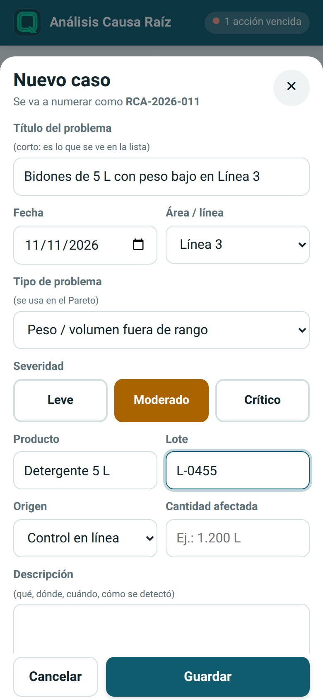

- **Título**: corto, es lo que se ve en la lista. Es obligatorio.
- **Tipo de problema**: también obligatorio, porque con él se arma el **Pareto**.
- **Severidad**: Leve, Moderado o Crítico.
- **Área / línea, producto, lote, origen** (cómo se detectó) y **cantidad afectada**.
- **Descripción**: qué pasó, dónde, cuándo y cómo se detectó.

El caso **se numera solo**: `RCA-2026-001`, `RCA-2026-002`… Al guardar se abre la ficha del
caso, con su estado y una barra con los 6 pasos. Cada paso se pinta cuando está completo.

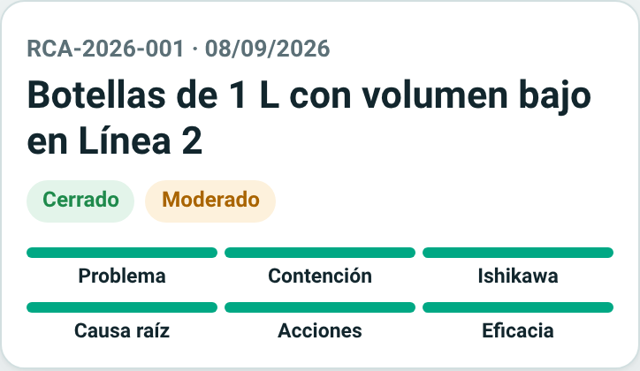

El **estado** no se elige: la app lo calcula con lo que cargaste.

| Estado | Cuándo |
|--------|--------|
| En análisis | Todavía no hay causa raíz |
| Acciones en curso | Hay causa raíz, pero faltan acciones o hay acciones pendientes |
| Verificar eficacia | Todas las acciones están hechas |
| No eficaz | Se verificó y el problema volvió: hay que revisar el análisis |
| Cerrado | Se verificó que fue eficaz |

## 3. Contención

Es lo que hiciste **en el momento** para que no siga saliendo producto con el problema:
retener, separar, reinspeccionar. No es la solución de fondo; esa viene después.

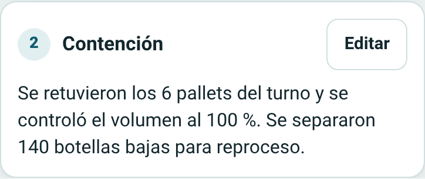

## 4. Ishikawa (6M)

Tocá **Cargar causas** y anotá las causas **posibles** en cada una de las 6M, **una por
renglón**: Método, Máquina, Mano de obra, Material, Medición y Medio ambiente. Todavía no
hace falta saber cuál es la real: es una lluvia de ideas ordenada.

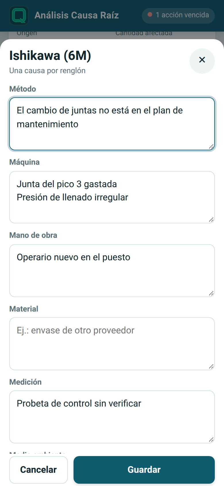

Al guardar, la app dibuja la **espina de pescado**. En el celular el dibujo se desliza hacia
los costados; en una tablet o en la compu se ve entero. Las causas marcadas como raíz
aparecen en rojo con una ★.

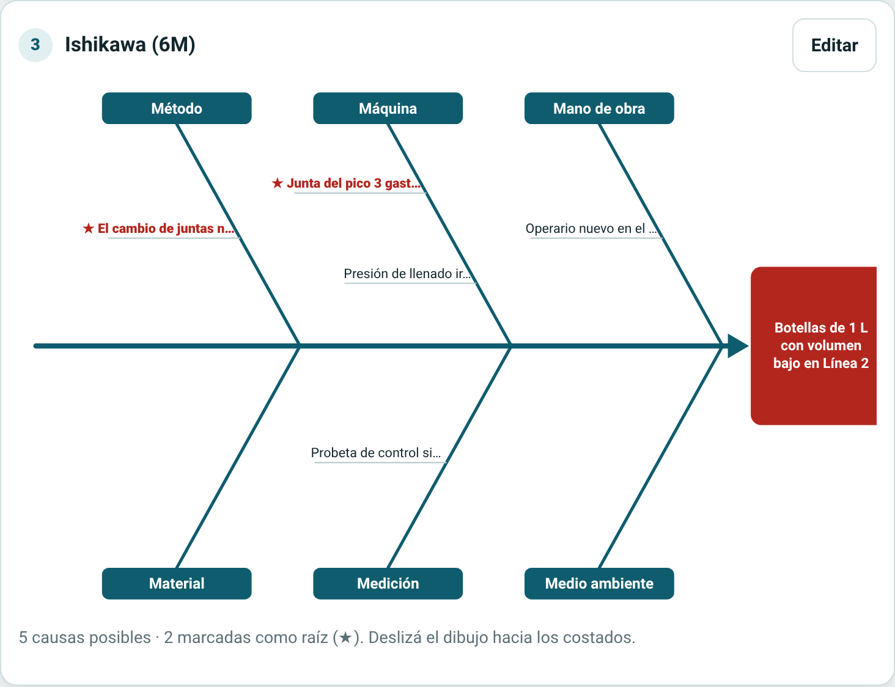

## 5. 5 por qué y causa raíz

Tocá **Analizar**. Preguntá **"¿por qué?"** empezando por el problema, y en cada renglón
respondé el por qué del anterior. No hace falta llegar a 5: cortá cuando la respuesta sea
algo que, si se corrige, evita que vuelva a pasar.

Más abajo, en el mismo formulario:

- **Marcá qué causas del Ishikawa son causa raíz.** Esto alimenta el Pareto por 6M.
- Escribí la **causa raíz** en una frase. El botón **Usar la respuesta del último "por qué"**
  la copia de la última respuesta, para no tipearla de nuevo.

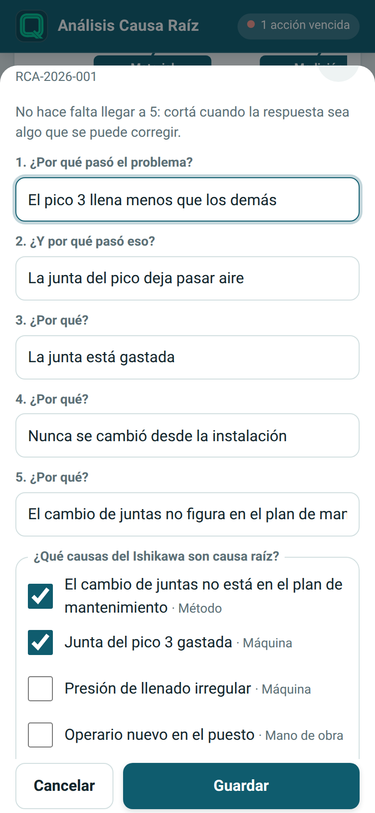 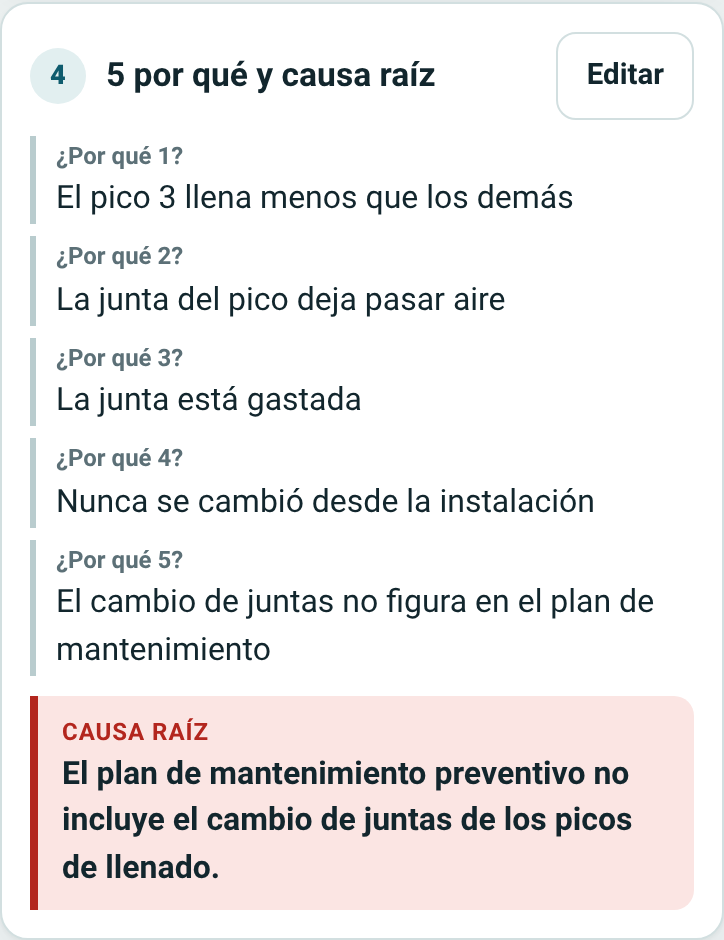

## 6. Plan de acción

Tocá **+ Acción** por cada cosa que se va a hacer para atacar la causa raíz:

- **Tipo**: *Correctiva* (elimina la causa de este problema) o *Preventiva* (evita que pase
  algo parecido en otro lado).
- **Qué se va a hacer**, **responsable** y **plazo**.
- **Ya está hecha**: al tildarla pide la fecha en que se hizo.

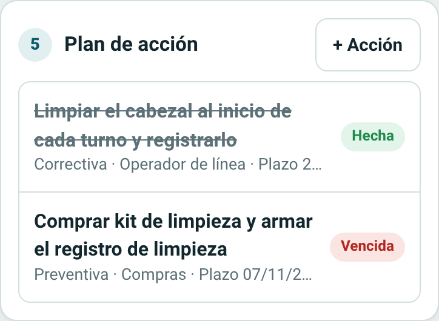 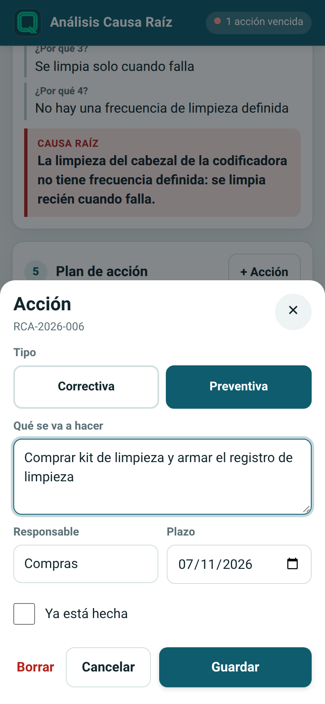

Una acción sin hacer cuyo plazo ya pasó se marca **Vencida** y se cuenta en los indicadores y
en la barra superior. Para marcar una acción como hecha, tocala y tildá **Ya está hecha**.

## 7. Verificación de eficacia

Cuando todas las acciones están hechas, dejá pasar un tiempo y comprobá que el problema **no
volvió a aparecer**. Tocá **Verificar**:

- **Eficaz**: el caso se **cierra**. Solo se puede si hay causa raíz y todas las acciones
  están hechas; si falta algo, la app te dice qué.
- **No eficaz**: el problema volvió. El caso queda abierto para revisar el análisis y las
  acciones.
- Anotá la **evidencia**: cómo comprobaste el resultado (registros, semanas sin desvíos…).

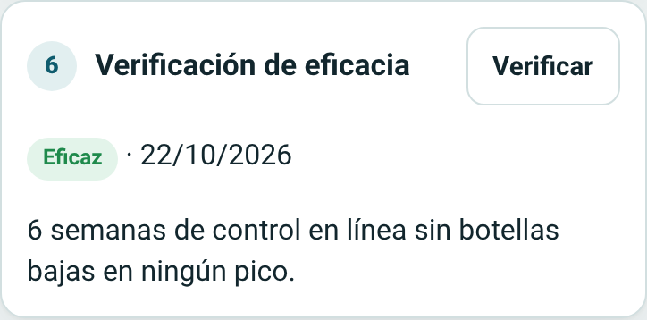

Cada cambio importante queda en el **Historial del caso**, al final de la ficha, con fecha y
hora: es la trazabilidad del análisis.

## 8. Informe y PDF

En la ficha, **Ver informe** arma el informe del caso: datos del problema, contención,
Ishikawa, 5 por qué, causa raíz, plan de acción, eficacia e historial, con el nombre y logo
de tu empresa y el código del registro al pie.

- **Imprimir / PDF**: en el diálogo de impresión elegí *Guardar como PDF*. Sale en hoja A4.
- **Compartir resumen**: manda un texto corto por WhatsApp, mail o lo que tengas en el
  celular (en la compu lo copia).

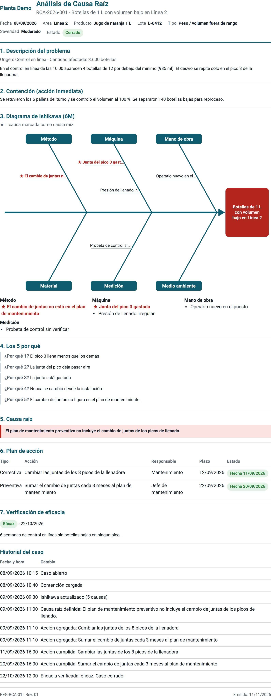

## 9. Pareto

La pestaña **Pareto** muestra qué problemas se repiten más, en el período que elijas (por
defecto, el año en curso). Se puede agrupar por:

- **Tipo de problema**: cuántos casos hubo de cada tipo.
- **Causa raíz (6M)**: en qué M están las causas marcadas como raíz. Los casos que todavía no
  tienen causa raíz no entran.
- **Área / línea**.

Las barras van de mayor a menor, con la línea del **% acumulado** y la marca del **80 %**. La
app te dice en qué categorías se concentra ese 80 %: eso es lo que conviene atacar primero.
**Imprimir / PDF** también funciona acá.

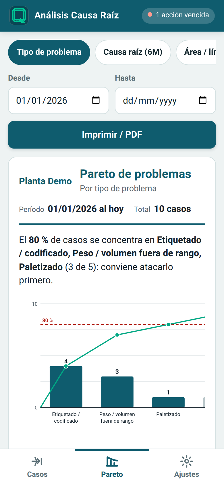 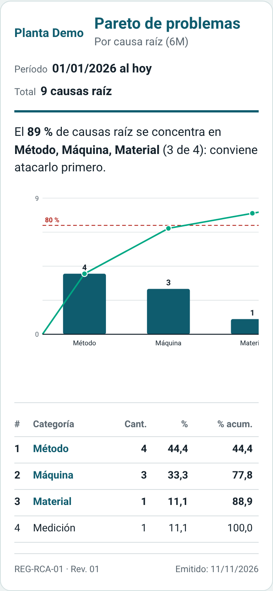

## 10. Ajustes y respaldo

En **Ajustes** adaptás la app a tu planta:

- **Empresa**: nombre y logo para el encabezado de los informes.
- **Tu nombre**: sale como "Elaboró" en el informe y como responsable por defecto de las acciones.
- **Listas**: áreas o líneas, tipos de problema (las barras del Pareto) y orígenes, uno por renglón.
- **Código del registro y revisión**, para el pie del informe.

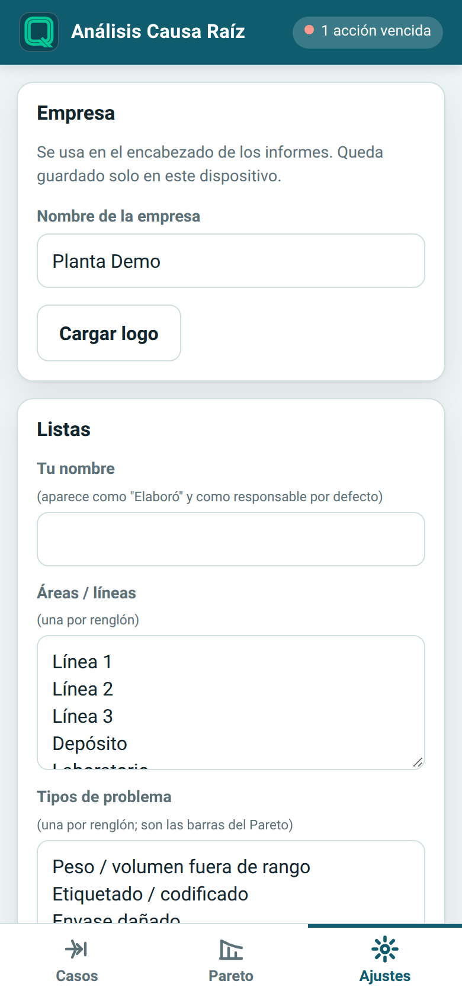 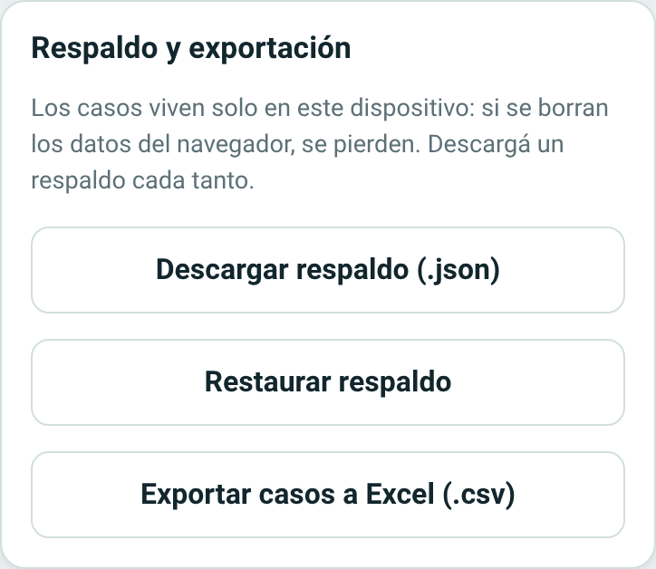

**Respaldo y exportación:**

- **Descargar respaldo (.json)**: una copia de todos tus casos y ajustes. Hacelo cada tanto.
- **Restaurar respaldo**: vuelve a cargar una copia. **Reemplaza** todo lo que hay.
- **Exportar casos a Excel (.csv)**: una fila por caso, lista para abrir en Excel.

## 11. Preguntas frecuentes

**¿Funciona sin señal?** Sí. Después de abrirla una vez con conexión, abre y guarda sin
señal. Los datos nunca salen del dispositivo, así que no hay nada que "subir".

**¿Otra persona puede ver mis casos?** No. No hay cuentas ni servidor: los casos viven solo
en el navegador donde los cargaste. Para pasarlos a otro dispositivo, usá **Descargar
respaldo** y **Restaurar respaldo**.

**¿Qué pasa si borro los datos del navegador o cambio de celular?** Se pierden los casos,
salvo que tengas un respaldo. Por eso conviene descargarlo cada tanto.

**¿Puedo cerrar un caso sin causa raíz?** No: para marcarlo eficaz tiene que tener causa raíz
y todas las acciones hechas. Es a propósito, para que un caso cerrado sea un caso resuelto.

**¿Se ve en modo oscuro?** Sí, toma el modo claro u oscuro de tu celular.

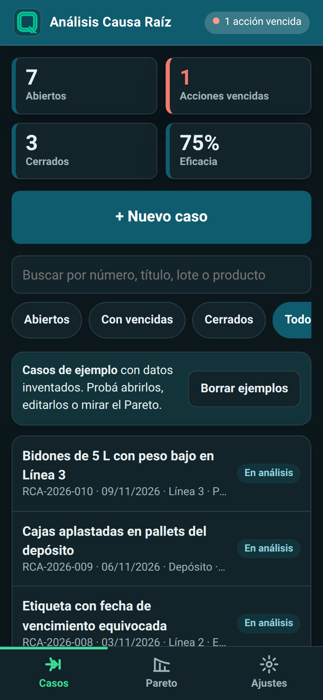

**Los ejemplos me molestan, ¿cómo los saco?** En la lista, **Borrar ejemplos**. Tus casos
quedan.
